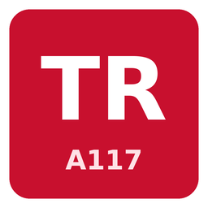
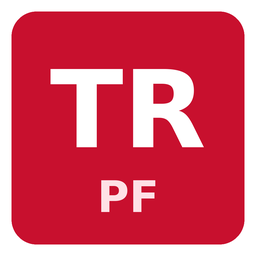

  

<h1 align="center">erkemoz Türkçe Oyun Yamaları</h1>

  <b>Oyunlar için ücretsiz Türkçe yamalar</b> 
  <i>Free Turkish translation patches for games</i> 
  🌐 <a href="https://erkemoz.app/turkce-yamalar/">erkemoz.app</a> — ücretsiz Windows uygulamaları ve Türkçeleştirme çalışmaları

---

## Yamalar

| | Oyun | Sürüm | İndir |
|---|---|---|---|
|  | **Anno 117: Pax Romana** (Ubisoft Connect, Steam) | v1.0 | [Kurulum ve exe'siz paket](https://github.com/erkemoz-wq/erkemoz-turkce-yamalar/releases/tag/anno117-v1.0) |
|  | **Mist Survival** (Steam) | v1.0 | [Kurulum ve exe'siz paket](https://github.com/erkemoz-wq/erkemoz-turkce-yamalar/releases/tag/mistsurvival-v1.0) |
|  | **Permafrost** (Steam, Erken Erişim) | v0.1 | [Kurulum ve exe'siz paket](https://github.com/erkemoz-wq/erkemoz-turkce-yamalar/releases/tag/permafrost-v0.1) |
|  | **Impossible Creatures** (Steam) | v1.1 | [Kurulum](https://github.com/erkemoz-wq/erkemoz-turkce-yamalar/releases/tag/impossiblecreatures-v1.1) |

## Kurulum

**Kurulum dosyasıyla (önerilen):** `..._TurkceYama_..._erkemoz.exe` dosyasını indirip çalıştır. Kurulum oyun klasörünü kendisi bulur; bulamazsa klasörü sen seçersin. Yamayı kaldırmak için Denetim Masası'nı ya da oyun klasöründeki kaldırıcıyı kullan.

Windows **"Bilgisayarınız korundu"** (SmartScreen) derse **Ek bilgi → Yine de çalıştır**'a tıkla. Bu uyarı, kurulum dosyaları ücretli bir kod imzalama sertifikasıyla imzalanmadığı için çıkar.

**Exe'siz paketle:** zip'i aç, içindeki `KURULUM.txt`'deki adımları izle. Genelde tek bir klasörü ya da dosyayı oyun klasörüne kopyalamak yeter.

## Oyuna göre notlar

- **Anno 117: Pax Romana:** Oyun dilini **English** bırak, metinler Türkçe görünür. Oyunun yazı tipinde ğ, ı, İ, ş harfleri olmadığı için bunlar g, i, I, s olarak yazılır.
- **Mist Survival:** Ekranın 16:10 ise oyunda 16:9 bir çözünürlük (ör. 1920×1080) seç; arayüz tam sığar.
- **Permafrost:** Oyunda **Settings → General → Language → Türkçe**. Oyun Erken Erişim'de; güncellemelerle gelen yeni metinler yama güncellenene kadar İngilizce görünür.

## Bilmen gerekenler

- Yamalar ücretsizdir. İnternete bağlanmaz, bilgi toplamaz ya da göndermez.
- Her sürüm notunda kurulum dosyasının SHA-256 parmak izi yazar.
- Oyunlar ve adları yapımcılarına aittir. Bu yamalar resmî değildir; oyunların yapımcıları ya da yayıncılarıyla bağlantısı yoktur. Oyunu kendi kopyandan oynamalısın.
- Bir hata ya da eksik çeviri görürsen yaz: [erkemoz@proton.me](mailto:erkemoz@proton.me)

---

## English

Free, unofficial Turkish translation patches. Download the installer (`.exe`) from the release of your game and run it; it finds the game folder itself and adds an uninstaller. The patches never connect to the internet. Games and their names belong to their respective owners.

---

☕ İşine yaradıysa / If it helps you: <a href="https://buymeacoffee.com/erkemoz"><b>Bana bir kahve ısmarla · Buy me a coffee</b></a>

© erkemoz · <a href="https://erkemoz.app">erkemoz.app</a> · <a href="mailto:erkemoz@proton.me">erkemoz@proton.me</a>

